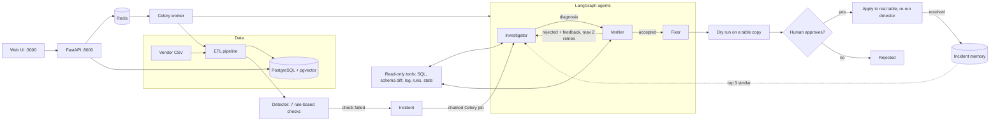

# PipelineDoctor AI

A learning project: a small ETL pipeline loads daily vendor data into PostgreSQL, rule-based checks watch every run, and when a check fails a team of AI agents works out **why**, proposes a fix, proves it on a copy of the table, and waits for a human to approve it.

The complexity lives in the agent logic, not the infrastructure. Everything is plain Python, one concern per file.

> **Status:** the whole system is built and each part is tested. Real end-to-end LLM runs are limited by free-tier API quotas, so there are **no real accuracy numbers yet** (see [Eval results](#eval-results)).

## What it does

1. **ETL pipeline:** reads a day's vendor CSV, cleans it with pandas, joins it with `customers` and `products`, loads `orders`, and records the run in `pipeline_runs` plus a text log.
2. **Fault injector:** breaks the next day's feed in a chosen way (renamed column, null spike, duplicates, row-count drop, currency unit change, timezone shift, join fan-out, partial feed, or two at once). The truth is saved in `ground_truth`, which agents can never read.
3. **Detector (no LLM):** seven checks compare the run with earlier healthy runs. Failed checks open an **incident**.
4. **Investigator agent (LangGraph):** forms hypotheses and gathers evidence with read-only tools.
5. **Verifier agent:** re-runs every piece of evidence with its own queries. A weak diagnosis goes back to the Investigator (max 2 retries).
6. **Fixer agent:** proposes SQL. The fix is **dry-run on a temporary copy** of `orders` and shown as a before/after comparison with the checks re-run. Nothing touches real data until you click approve.
7. **Incident memory:** resolved incidents are stored with an embedding in pgvector. The Investigator recalls the 3 most similar past incidents before it starts.
8. **Trace:** every agent step (tool calls, LLM calls, tokens, timings) is stored, so you can see exactly how a diagnosis was reached.
9. **Evals:** each fault is run end to end and a fixed judge model grades the diagnosis against `ground_truth`.

## Architecture



Slow work (pipeline runs, investigations, applying fixes, evals) runs as Celery jobs. The API returns a `job_id` immediately and the UI polls the `jobs` table.

## Tech stack

Python 3.12, FastAPI, pandas, PostgreSQL + pgvector, LangGraph, Pydantic, Groq (model set in `.env`), local sentence-transformers embeddings, Celery + Redis, Docker Compose, plain HTML/CSS/JS served by nginx. An optional Gemini fallback is used when Groq is rate limited.

## Run it with Docker

Requirements: Docker Desktop, and a free [Groq API key](https://console.groq.com/keys).

```bash
cp .env.example .env          # then put your GROQ_API_KEY in .env (PowerShell: Copy-Item .env.example .env)
docker compose up -d --build  # first build downloads PyTorch, so it takes a few minutes

docker compose exec api python -m scripts.setup_db     # create tables
docker compose exec api python -m scripts.seed         # customers, products, 7 clean days of feeds
docker compose exec api python -m scripts.run_pipeline # load the 7 clean days
```

Open **http://localhost:3000**. Type a fault such as `currency_unit` into the box and click **Run next day**. The pipeline runs, the detector opens an incident, and the agents start working. Open the incident to see the diagnosis, the dry-run comparison and the full agent trace, then approve or reject the fix.

Useful commands:

```bash
docker compose logs -f worker            # watch the agents work
docker compose exec api bash             # shell inside a container
docker compose restart worker            # after changing worker code (the API reloads by itself)
docker compose exec api python -m scripts.setup_db   # reset the tables (then seed + run_pipeline again)
docker compose down -v                   # wipe everything, including volumes
```

The API docs are at http://localhost:8000/docs.

### Optional: Gemini fallback

Add to `.env` (free key from [Google AI Studio](https://aistudio.google.com/apikey)):

```
GEMINI_API_KEY=your-key
FALLBACK_MODEL=gemini-2.5-flash
```

On a Groq rate limit, calls switch to Gemini and stay there for 5 minutes. This path has not been run against the real Gemini API yet.

## API

| Endpoint | Purpose |
|---|---|
| `POST /pipeline/run` | Run the next day, optionally with a fault. Returns a `job_id` |
| `GET /incidents`, `GET /incidents/{id}` | Incidents; detail has checks, diagnoses, verdicts, fix, dry run and the trace |
| `POST /fixes/{id}/approve`, `/reject` | Approve (a job applies it) or reject a pending fix |
| `POST /eval/run`, `GET /eval/{id}` | Start an eval job; read its report |
| `GET /jobs/{id}` | Job status: queued, running, done or failed, with progress |
| `GET /overview` | Everything the watch screen shows, in one call |

## Evals

```bash
docker compose exec api python -m scripts.run_eval --faults currency_unit,timezone_shift --runs 1
docker compose exec api python -m scripts.run_eval --faults currency_unit --prompts v1,v2      # compare prompts
docker compose exec api python -m scripts.run_eval --faults currency_unit --models openai/gpt-oss-120b,qwen/qwen3.8-27b
```

Each case injects a fault, runs the full flow, and a fixed judge model grades the diagnosis against the known truth using a written rubric (`correct`, `partial`, `wrong`). The report shows accuracy, verifier rejections, average tool calls, tokens and time per fault, plus a side-by-side view when comparing variants. The Gemini fallback is switched off during evals so a rate limit cannot silently change the model being tested.

Every case costs real LLM tokens. Start with one or two faults.

### Eval results

**Not available yet.** The harness is tested with scripted fake agents, but real runs so far were stopped by free-tier limits (see below). This section will hold the per-fault table once a real run completes.

## Project layout

```
app/
  config.py, db.py, llm.py        settings, database helpers, LLM calls (Groq + Gemini fallback)
  pipeline.py, faults.py, injector.py   the ETL run and the fault injection
  detector.py                     the 7 checks
  tools.py, trace.py              agent tools (read-only) and the step recorder
  agents/                         base loop, investigator, verifier, team (the loop), fixer
  fixes.py, memory.py             dry run / approve / reject, and pgvector incident memory
  evals.py                        eval harness, judge, report
  celery_app.py, tasks.py, jobs.py   background jobs
  api/main.py                     FastAPI endpoints
db/schema.sql                     all tables
frontend/                         the watch screen (plain HTML/CSS/JS + nginx config)
scripts/                          setup, seed, run_pipeline, inject_fault, run_detector, run_eval, ...
```

## Interesting failures and what I learned

1. **A dry run that passed, then the real check failed.** After an approved fix deleted fan-out rows, the detector still flagged `row_count_change`, because `pipeline_runs.rows_loaded` still held the old count while the dry run used the new one. The dry run and the real check were measuring different things. Fix: the approve step updates `rows_loaded` in the same transaction. Lesson: a sandbox only proves what it actually measures.
2. **Memory that remembered nothing.** Incident memory is built from the failed checks, but the detector re-runs after a fix and replaces those checks with passing ones, so the stored symptoms were empty. Fix: read the symptoms before applying the fix. Lesson: when a later step overwrites the data you need, capture it first.
3. **Real models are not interchangeable.** On a free Groq key, the same eval case ended three different ways: a daily token limit on one model, unparseable structured output (`output_parse_failed`) on a smaller one, and a "request too large" rejection on a third. Lesson: handle each failure explicitly (stop the eval on rate limits, record other errors per case), and never let a fallback silently change the model under test.

## Limitations

- No real accuracy numbers yet; agent prompts have not been tuned against real model runs.
- The SQL tool blocks `ground_truth` by text match; a separate database role with no grant would be stricter.
- A retried investigation appends extra steps to the trace.
- The UI is dark only and polls instead of streaming.
