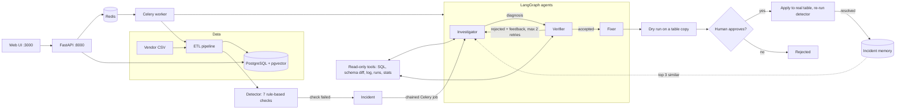

# PipelineDoctor AI

A learning project: a small ETL pipeline loads daily vendor data into PostgreSQL, rule-based checks watch every run, and when a check fails a team of AI agents works out **why**, proposes a fix, proves it on a copy of the table, and waits for a human to approve it.

The complexity lives in the agent logic, not the infrastructure. Everything is plain Python, one concern per file.

> **Status:** the whole system is built and each part is tested. Real end-to-end LLM runs are limited by free-tier API quotas, so there are **no real accuracy numbers yet** (see [Eval results](#eval-results)).

## What it does

1. **ETL pipeline:** reads a day's vendor CSV, cleans it with pandas, joins it with `customers` and `products`, loads `orders`, and records the run in `pipeline_runs` plus a text log.
2. **Fault injector:** breaks the next day's feed in a chosen way (renamed column, null spike, duplicates, row-count drop, currency unit change, timezone shift, join fan-out, partial feed, or two at once). The truth is saved in `ground_truth`, which agents can never read.
3. **Detector (no LLM):** seven checks compare the run with earlier healthy runs. Failed checks open an **incident**.
4. **Investigator agent (LangGraph):** forms hypotheses and gathers evidence with read-only tools.
5. **Verifier agent:** re-runs every piece of evidence with its own queries. A weak diagnosis goes back to the Investigator (max 2 retries).
6. **Fixer agent:** proposes SQL. The fix is **dry-run on a temporary copy** of `orders` and shown as a before/after comparison with the checks re-run. Nothing touches real data until you click approve.
7. **Incident memory:** resolved incidents are stored with an embedding in pgvector. The Investigator recalls the 3 most similar past incidents before it starts.
8. **Trace:** every agent step (tool calls, LLM calls, tokens, timings) is stored, so you can see exactly how a diagnosis was reached.
9. **Evals:** each fault is run end to end and a fixed judge model grades the diagnosis against `ground_truth`.
10. **Watch your own database (no LLM):** connect a Postgres database, scan it, choose tables, and the system learns what a normal day looks like and checks every new day, with weekday-aware baselines, an events calendar, and human feedback on alerts. See [Watch your own database](#watch-your-own-database).

## Architecture



Slow work (pipeline runs, investigations, applying fixes, evals) runs as Celery jobs. The API returns a `job_id` immediately and the UI polls the `jobs` table.

## Tech stack

Python 3.12, FastAPI, pandas, PostgreSQL + pgvector, LangGraph, Pydantic, Groq (model set in `.env`), local sentence-transformers embeddings, Celery + Redis, Docker Compose, plain HTML/CSS/JS served by nginx. An optional Gemini fallback is used when Groq is rate limited.

## Run it with Docker

Requirements: Docker Desktop, and a free [Groq API key](https://console.groq.com/keys).

```bash
cp .env.example .env          # then put your GROQ_API_KEY in .env (PowerShell: Copy-Item .env.example .env)
docker compose up -d --build  # first build downloads PyTorch, so it takes a few minutes

docker compose exec api python -m scripts.setup_db     # create tables
docker compose exec api python -m scripts.seed         # customers, products, 7 clean days of feeds
docker compose exec api python -m scripts.run_pipeline # load the 7 clean days
```

Open **http://localhost:3000**. Type a fault such as `currency_unit` into the box and click **Run next day**. The pipeline runs, the detector opens an incident, and the agents start working. Open the incident to see the diagnosis, the dry-run comparison and the full agent trace, then approve or reject the fix.

Useful commands:

```bash
docker compose logs -f worker            # watch the agents work
docker compose exec api bash             # shell inside a container
docker compose restart worker            # after changing worker code (the API reloads by itself)
docker compose exec api python -m scripts.setup_db   # reset the tables (then seed + run_pipeline again)
docker compose down -v                   # wipe everything, including volumes
```

The API docs are at http://localhost:8000/docs.

**Ports already used?** Postgres (5432), Redis (6379) and the web page (3000) are published on your PC. If another project uses them, set `POSTGRES_PORT`, `REDIS_PORT` and `FRONTEND_PORT` in `.env` (for example 5433, 6380, 3001), and open `http://localhost:<FRONTEND_PORT>`. Inside Docker the services always talk on their normal ports.

### Optional: Gemini fallback

Add to `.env` (free key from [Google AI Studio](https://aistudio.google.com/apikey)):

```
GEMINI_API_KEY=your-key
FALLBACK_MODEL=gemini-2.5-flash
```

On a Groq rate limit, calls switch to Gemini and stay there for 5 minutes. This path has not been run against the real Gemini API yet.

## API

| Endpoint | Purpose |
|---|---|
| `POST /pipeline/run` | Run the next day, optionally with a fault. Returns a `job_id` |
| `GET /incidents`, `GET /incidents/{id}` | Incidents; detail has checks, diagnoses, verdicts, fix, dry run and the trace |
| `POST /fixes/{id}/approve`, `/reject` | Approve (a job applies it) or reject a pending fix |
| `POST /eval/run`, `GET /eval/{id}` | Start an eval job; read its report |
| `GET /jobs/{id}` | Job status: queued, running, done or failed, with progress |
| `GET /overview` | Everything the watch screen shows, in one call |

## Evals

```bash
docker compose exec api python -m scripts.run_eval --faults currency_unit,timezone_shift --runs 1
docker compose exec api python -m scripts.run_eval --faults currency_unit --prompts v1,v2      # compare prompts
docker compose exec api python -m scripts.run_eval --faults currency_unit --models openai/gpt-oss-120b,qwen/qwen3.8-27b
```

Each case injects a fault, runs the full flow, and a fixed judge model grades the diagnosis against the known truth using a written rubric (`correct`, `partial`, `wrong`). The report shows accuracy, verifier rejections, average tool calls, tokens and time per fault, plus a side-by-side view when comparing variants. The Gemini fallback is switched off during evals so a rate limit cannot silently change the model being tested.

Every case costs real LLM tokens. Start with one or two faults.

### Eval results

**Not available yet.** The harness is tested with scripted fake agents, but real runs so far were stopped by free-tier limits (see below). This section will hold the per-fault table once a real run completes.

## Watch your own database

The **Data sources** tab connects PipelineDoctor to a database and watches tables in it. This part uses no LLM, so it costs no tokens. Postgres only for now.

**The flow**
1. **Connect** with host, port, database, user and password. The password is stored encrypted. The tool reads the user's privileges and **warns if the user can write** (it never tries to write; its own sessions are always read-only). Use a SELECT-only user.
2. **Scan** lists the tables, best candidates first (tables that keep receiving new rows).
3. **Choose a table.** The time column and key column are suggested, and likely personal columns (email, name, phone...) are pre-ticked as **never read**.
4. **Learn.** It reads the last 60 days, builds per-day numbers (row count, null rates, averages, duplicates, last row time), and needs 5 healthy days before it starts checking.
5. **Check** the latest complete day with 7 checks: `schema_change`, `row_count_change`, `null_rate`, `value_distribution`, `duplicate_keys`, `lookalike_rows` (copies with different ids), `late_or_partial`. A failure opens an alert.

**It understands normal rhythms**
- **Same-weekday baseline:** a Saturday is compared with earlier Saturdays (when there are at least 3), so busy weekends do not cause false alarms and a drop on a busy day is not hidden.
- **Events calendar:** mark a date range (a sale, a festival) with the expected change, for example "rows x3". During it, that table expects the change and the check says why ("expected x3 for Diwali sale"). Event days stay out of the normal baseline. "Any change is fine" and "all my tables" are options.
- **Human feedback on alerts:** *Real problem* confirms it. *Normal, just this day* dismisses it and the day joins the baseline. *Normal, it is an event...* opens an event form pre-filled with the observed change, then re-checks the day.

Try it with the demo shop database (no setup beyond one command):

```bash
docker compose exec api python -m scripts.make_demo_target                          # 56 normal days, busier weekends
docker compose exec api python -m scripts.make_demo_target --anomaly sale_peak      # yesterday has 3x the orders
```

Other anomalies: `amount_x100`, `row_drop`, `mild_drop`, `null_spike`, `late_partial`, `duplicates`; add `--anomaly-days-ago 4` to damage an earlier day. In the UI: Data sources, **Fill in the demo database**, Connect, choose `public.sales`, then **Check now**.

**Not done yet:** alerts on watched tables do not start the AI agents (that needs an LLM), checks run when you click rather than on a schedule, events do not repeat yearly, and MySQL is not supported.

## Project layout

```
app/
  config.py, db.py, llm.py        settings, database helpers, LLM calls (Groq + Gemini fallback)
  pipeline.py, faults.py, injector.py   the ETL run and the fault injection
  detector.py                     the 7 checks
  tools.py, trace.py              agent tools (read-only) and the step recorder
  agents/                         base loop, investigator, verifier, team (the loop), fixer
  fixes.py, memory.py             dry run / approve / reject, and pgvector incident memory
  evals.py                        eval harness, judge, report
  targets.py, watch.py, vault.py  connect to a customer database, learn and check tables, encrypt passwords
  api/watch.py                    endpoints for connections, watched tables, events and alert decisions
  celery_app.py, tasks.py, jobs.py   background jobs
  api/main.py                     FastAPI endpoints
db/schema.sql                     all tables
frontend/                         the watch screen (plain HTML/CSS/JS + nginx config)
scripts/                          setup, seed, run_pipeline, inject_fault, run_detector, run_eval, ...
```

## Interesting failures and what I learned

1. **A dry run that passed, then the real check failed.** After an approved fix deleted fan-out rows, the detector still flagged `row_count_change`, because `pipeline_runs.rows_loaded` still held the old count while the dry run used the new one. The dry run and the real check were measuring different things. Fix: the approve step updates `rows_loaded` in the same transaction. Lesson: a sandbox only proves what it actually measures.
2. **Memory that remembered nothing.** Incident memory is built from the failed checks, but the detector re-runs after a fix and replaces those checks with passing ones, so the stored symptoms were empty. Fix: read the symptoms before applying the fix. Lesson: when a later step overwrites the data you need, capture it first.
3. **Real models are not interchangeable.** On a free Groq key, the same eval case ended three different ways: a daily token limit on one model, unparseable structured output (`output_parse_failed`) on a smaller one, and a "request too large" rejection on a third. Lesson: handle each failure explicitly (stop the eval on rate limits, record other errors per case), and never let a fallback silently change the model under test.

## Limitations

- No real accuracy numbers yet; agent prompts have not been tuned against real model runs.
- The SQL tool blocks `ground_truth` by text match; a separate database role with no grant would be stricter.
- A retried investigation appends extra steps to the trace.
- Watched-table checks use fixed minimum thresholds (25% for rows, 40% for averages) widened by how much a table normally varies; real tables will need tuning.
- The UI is dark only and polls instead of streaming.
